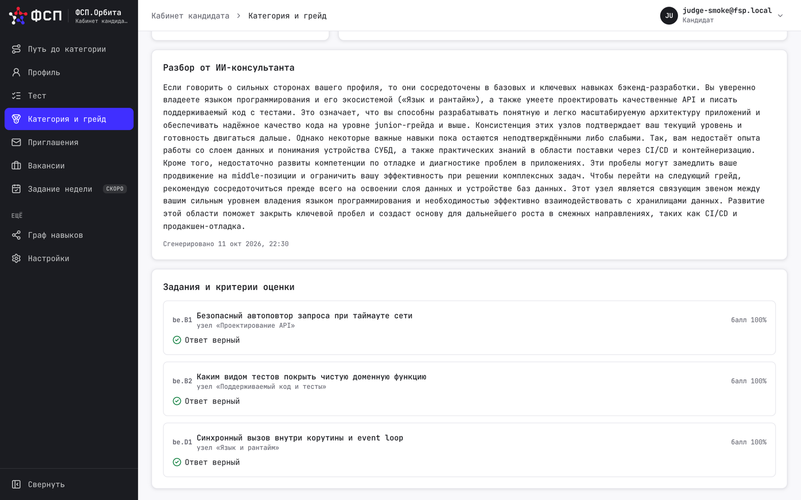
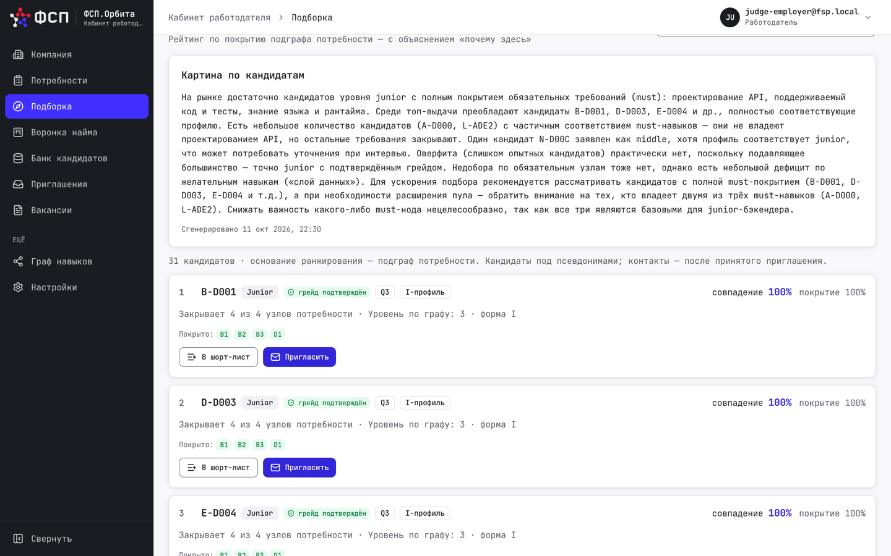
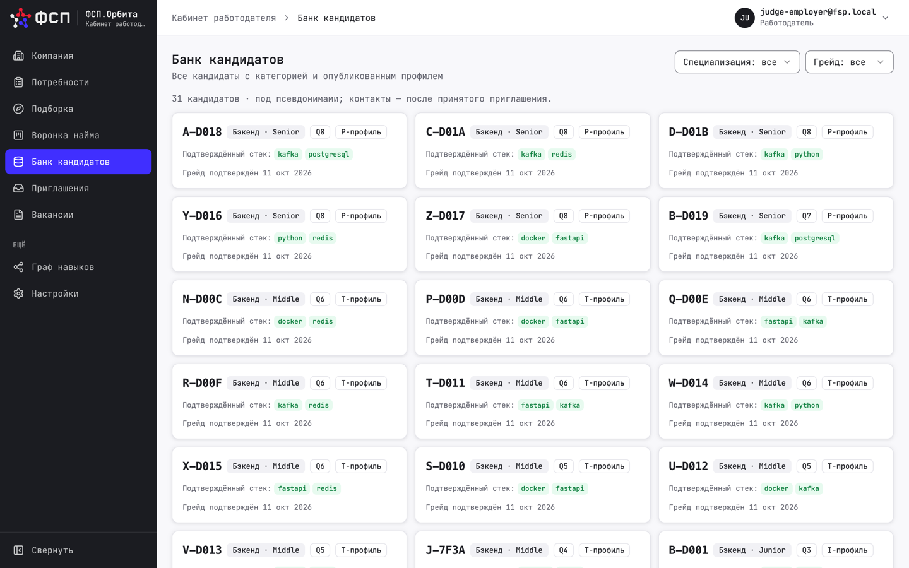
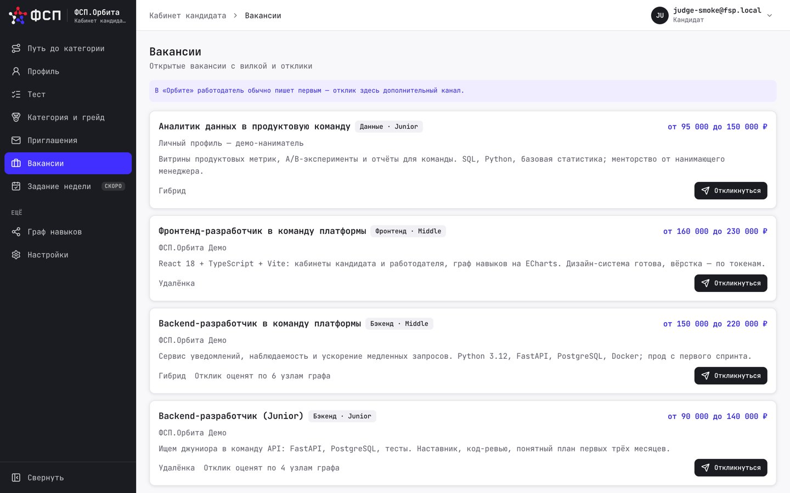
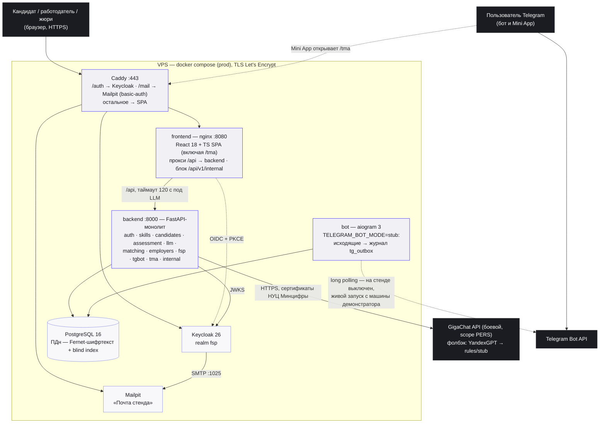
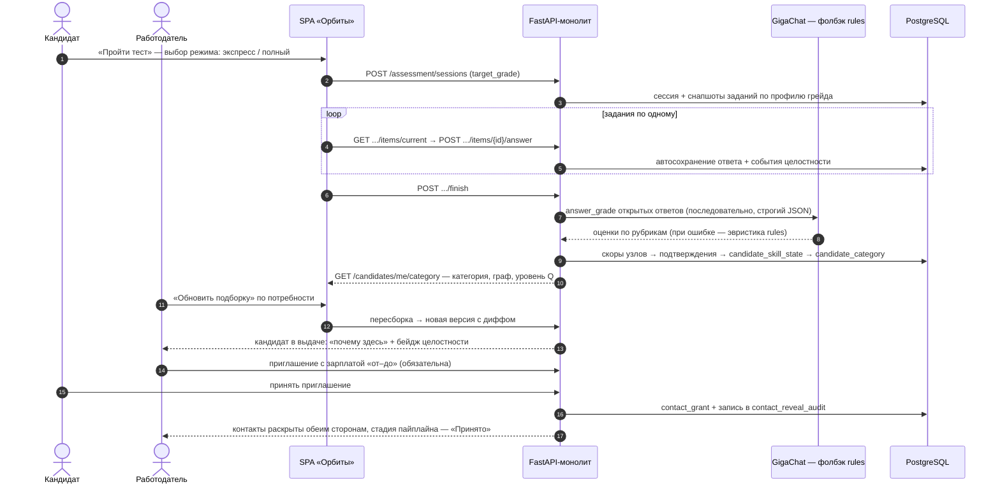
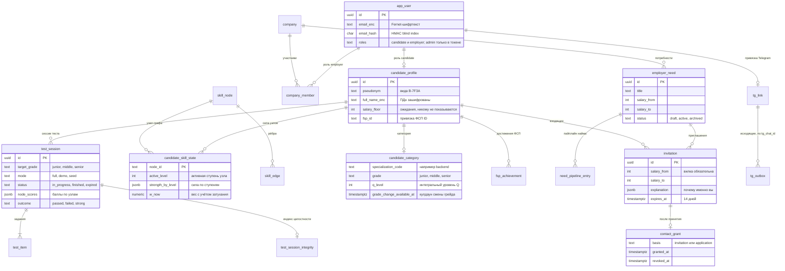

# ФСП.Орбита

**Платформа обратного подбора: кандидат не пишет резюме — он подтверждает узлы графа
навыков тестом и достижениями ФСП, а работодатель получает объяснимую подборку и первым
выходит на контакт с зарплатой «от–до».** Решение спец. трека Федерации спортивного
программирования на хакатоне «Лидеры цифровой трансформации 2026».

[](../../actions/workflows/ci.yml)


> **🔗 Живой стенд**
> Приложение: **https://orbita.185.239.51.92.nip.io** · Swagger: https://orbita.185.239.51.92.nip.io/api/v1/docs
> Войти за минуту: `judge-candidate@fsp.local` / `judge-employer@fsp.local`, пароль у обоих
> `Orbita-Judge-2026`; кандидат с готовым результатом — `judge-smoke@fsp.local` / `Orbita-Smoke-2026`.
> Все учётки и пароли — в разделе [«Как посмотреть за 5 минут»](#как-посмотреть-за-5-минут).
> Keycloak: https://orbita.185.239.51.92.nip.io/auth (realm `fsp`)
> Telegram-бот: [@OrbitaFspBot](https://t.me/OrbitaFspBot) · Mini App: https://orbita.185.239.51.92.nip.io/tma

## Оглавление

- [О системе](#о-системе)
- [Возможности](#возможности)
- [Как посмотреть за 5 минут](#как-посмотреть-за-5-минут)
- [Путь кандидата](#путь-кандидата)
- [Путь работодателя](#путь-работодателя)
- [Скриншоты](#скриншоты)
- [Быстрый старт](#быстрый-старт)
- [Архитектура](#архитектура)
- [Модель данных](#модель-данных)
- [Механики](#механики)
- [Телеграм-бот и Mini App](#телеграм-бот-и-mini-app)
- [Безопасность и 152-ФЗ](#безопасность-и-152-фз)
- [Тесты](#тесты)
- [Технологии](#технологии)
- [Структура репозитория](#структура-репозитория)
- [Документация](#документация)
- [План развития](#план-развития)
- [Лицензия и команда](#лицензия-и-команда)

## О системе

«Орбита» переворачивает классический найм. Вместо резюме у кандидата — **граф навыков
с затухающими подтверждениями**: каждый узел подтверждается адаптивным тестом,
достижениями из реестра ФСП или регулярными заданиями, и каждое подтверждение со
временем теряет вес, поэтому профиль всегда отражает актуальную форму специалиста,
а не былые заслуги. По закрытому профилю грейда платформа присваивает категорию
(специализация + грейд + уровень Q) — её нельзя «написать», только подтвердить.

Работодатель описывает потребность текстом («кто нужен и задачи на первые 3 месяца»),
LLM разбирает её в редактируемый подграф узлов, и платформа строит **объяснимую
подборку**: у каждого кандидата — «почему здесь» (закрытые узлы, сила и свежесть
подтверждений, вклад достижений ФСП) и бейдж целостности тестовой сессии. Контакты
кандидата закрыты до тех пор, пока он не примет приглашение с обязательной зарплатной
вилкой «от–до» — первым на контакт выходит работодатель.

Технически это модульный монолит FastAPI (11 модулей), React 18 + TypeScript SPA,
PostgreSQL 16, self-hosted Keycloak 26 и Mailpit; телеграм-бот и Mini App работают
на тех же обработчиках, что веб. LLM-цепочка деградирует изящно:
GigaChat → YandexGPT → эвристики/заглушка — решение полностью работает без единого
ключа LLM. Всё разворачивается docker compose одной командой, локально или на VPS
(Caddy, автоматический TLS). Модель компетенций построена по мотивам «Квантовой
модели компетенций» К. Кичинского (2023); формулы силы узла, затухания и вывода
грейда — собственные.

## Возможности

- 🧭 **Граф навыков вместо резюме** — узлы по слоям и ступеням (`graph.yaml` по
  специализациям), подтверждения с начальным весом по источнику и экспоненциальным
  затуханием; активный уровень узла виден и кандидату, и работодателю.
- 📝 **Адаптивный тест на грейд с выбором режима** — на экране старта кандидат
  выбирает **экспресс** (до 5 заданий по демо-профилю грейда, быстрое знакомство
  за 5–8 минут) или **полный** (все узлы профиля грейда, с проверкой связей и
  пограничных узлов — система в полную силу). Автосохранение ответов, мягкий таймер,
  ранняя остановка маршрута.
- 🤖 **LLM-грейдинг открытых ответов** — судья `answer_grade` оценивает по рубрике
  шаблона строгим JSON; при любой ошибке LLM — эвристика по ключевым словам, сессия
  не падает. Закрытые вопросы проверяются детерминированно по ключу.
- 🎯 **Объяснимый подбор** — версии подборки со снимком подграфа и диффом
  («было 14 → стало 9»), закреплённые кандидаты, «почему здесь» у каждой строки;
  кандидаты с неподтверждённым грейдом — ниже выдачи, прозрачно.
- 🛡 **Сигналы целостности — флаги, а не вердикты** — крупные вставки, уходы со
  вкладки, слишком быстрые ответы; собираются только длины и тайминги, кандидат
  предупреждён баннером. Индекс high/medium/low — повод для вопроса на интервью,
  а не автоматический бан.
- 💼 **Приглашение с зарплатой «от–до»** — обязательная вилка, лимиты против спама
  (10 на потребность, 5 кандидату в сутки, одно открытое на пару «компания-кандидат»),
  срок жизни 14 дней; мини-CRM пайплайна найма: отправлено → принято → интервью →
  оффер → найм.
- 🔐 **Контакты — только после согласия** — раскрытие через `contact_grant` с записью
  в аудит; до принятия приглашения работодатель видит псевдоним («B-7F3A») и
  маскированные данные.
- 🏅 **Достижения ФСП** — верифицированные подтверждения узлов через маппинг дисциплин
  спортивного программирования на граф (модель данных и маппинг готовы, импорт из
  реестра — в доработке).
- 📱 **Телеграм-бот и Mini App** — уведомления о приглашениях, недельный дайджест,
  принятие приглашения и воронка потребности прямо в Telegram — теми же обработчиками,
  что веб, без дублирования правил.
- ⚖️ **152-ФЗ по построению** — Fernet-шифрование ПДн + HMAC blind index, маскирование
  по умолчанию, согласия с версией политики, аудит каждого раскрытия; ПДн не попадают
  в логи, кэш и промпты LLM.

## Как посмотреть за 5 минут

Открываете [стенд](https://orbita.185.239.51.92.nip.io), входите под кандидатом,
проходите экспресс-тест, затем в окне инкогнито входите под работодателем и смотрите,
как кандидат появился в подборке. Тестовые учётки стенда (синтетические демо-аккаунты):

| Где | Логин | Пароль | Что внутри |
|---|---|---|---|
| [Стенд](https://orbita.185.239.51.92.nip.io) | `judge-candidate@fsp.local` | `Orbita-Judge-2026` | кандидат: профиль заполнен — можно сразу пройти экспресс-тест |
| [Стенд](https://orbita.185.239.51.92.nip.io) | `judge-smoke@fsp.local` | `Orbita-Smoke-2026` | кандидат с уже пройденным тестом: категория, разбор, «Объяснить мой граф», «Мой граф» |
| [Стенд](https://orbita.185.239.51.92.nip.io) | `judge-employer@fsp.local` | `Orbita-Judge-2026` | работодатель: потребности, подборка с мэтчами, «Картина по кандидатам», банк, вакансии, воронка |
| [Почта стенда](https://orbita.185.239.51.92.nip.io/mail/) | `mail` | `UEoevfJrTFB1` | письма подтверждения при самостоятельной регистрации (любой адрес `*@fsp.local`) |

В выдаче работодателя уже живут 31 сид-кандидат с мэтчами — в том числе пара «близнецов»
(с достижениями ФСП и без них): удобно сравнить, как достижения влияют на рейтинг.

На стенде включены `TEST_DEMO_MODE=1` (экспресс-режим доступен с экрана старта) и
`DEMO_COOLDOWN_SECONDS=300` — повторный тест на другой грейд можно показать через
пять минут, а не через штатные 90 дней. Результат экспресс-сессии всюду помечен бейджем
«демо». Полный сценарий демонстрации с хронометражем — [docs/demo-script.md](docs/demo-script.md).

## Путь кандидата

1. **Войти** на [стенд](https://orbita.185.239.51.92.nip.io) под `judge-candidate@fsp.local`.
2. **Опрос** — профиль демо-кандидата уже заполнен; при регистрации нового аккаунта
   опрос заполняется за минуту.
3. **«Пройти тест» → режим «Экспресс»** — до 5 заданий по демо-профилю грейда,
   5–8 минут (режим «Полный» — все узлы профиля, система в полную силу).
4. **Категория и разбор** — на экране результата: специализация + грейд + уровень Q
   и объяснение, какие узлы закрыты и что подтянуть.
5. **Граф навыков → «Мой граф»** — узлы с активными уровнями, силой и свежестью
   подтверждений; видно, как подтверждения затухают со временем.

## Путь работодателя

1. **Войти** (лучше в окне инкогнито) под `judge-employer@fsp.local`.
2. **«Потребности»** — готовая потребность уже создана; текст «кто нужен и задачи на
   3 месяца» разобран LLM в редактируемый подграф узлов.
3. **«Подборка»** — рейтинг кандидатов, у каждой строки «почему здесь»: закрытые узлы,
   сила и свежесть подтверждений, вклад достижений ФСП, бейдж целостности. После
   экспресс-теста жюри нажмите «Обновить подборку» — свежепротестированный кандидат
   появится в выдаче.
4. **«Пригласить»** — приглашение с обязательной зарплатной вилкой «от–до»; контакты
   кандидата раскроются только после его согласия.
5. **Воронка найма** — мини-CRM: отправлено → принято → интервью → оффер → найм.

## Скриншоты

| | |
|---|---|
|  |  |
| *Старт теста: кандидат выбирает режим — экспресс или полный* | *Результат: категория (специализация + грейд + уровень Q) и разбор* |
|  |  |
| *«Мой граф»: узлы с активными уровнями и затухающими подтверждениями* | *Потребности работодателя: текст разобран в подграф узлов* |
|  |  |
| *Подборка: рейтинг с «почему здесь» и бейджем целостности* | *Воронка найма: от приглашения до оффера* |
|  |  |
| *«Объяснить мой граф»: ИИ разбирает сильные стороны и что подтянуть до следующего грейда* | *«Картина по кандидатам»: хватает ли кандидатов, оверфит или недобор, какие компромиссы* |
|  |  |
| *Банк кандидатов: все с категорией, фильтры по специализации и грейду* | *Вакансии: вилка «от–до» и отклик — дополнительный канал к приглашениям* |

## Быстрый старт

```sh
make dev                      # postgres + keycloak + mailpit + миграции + backend (hot-reload)
make demo                     # демо-данные: идемпотентный сид кандидатов, вакансий и мэтчей (= make seed)
cd frontend && npm ci && npm run dev    # SPA на :5173, прокси /api → :8000
```

`make dev` сам создаёт `deploy/compose/.env` (генерирует ключи шифрования ПДн и
токены; файл в git не входит и повторными запусками не перетирается). Остановить —
`make dev-down`, снести с томами — `make clean`.

| Адрес | Что это |
|---|---|
| http://localhost:8000/api/v1/docs | Swagger (OpenAPI 3) |
| http://localhost:5173 | SPA (vite dev; контейнерный вариант — `make dev-full` → :3000) |
| http://localhost:8080 | Keycloak, realm `fsp` (admin-пароль — `deploy/compose/.env`) |
| http://localhost:8025 | Mailpit — письма подтверждения и сброса пароля |

**Запуск без ключей LLM.** По умолчанию `LLM_PROVIDER=stub` (фикстуры) — весь цикл,
включая грейдинг и разбор потребности, работает офлайн. `replay` проигрывает записанные
ответы боевых моделей без сети, `rules` — эвристики по ключевым словам. Боевые
провайдеры (`gigachat`, `yandex`) включаются ключами в `backend/.env`
(см. [.env.example](.env.example)).

**Прод-стенд** (VPS, Caddy с автоматическим TLS):

```sh
VM_HOST=root@<ip> PUBLIC_DOMAIN=orbita.<ip-через-дефисы>.nip.io make prod-deploy
VM_HOST=root@<ip> PUBLIC_DOMAIN=... make prod-smoke   # smoke-проверка после деплоя
```

Подробности сборки и эксплуатации — [docs/08-run.md](docs/08-run.md).

## Архитектура

Один VPS, docker compose, вход через Caddy (автоматический HTTPS). Backend — модульный
монолит: границы модулей — внутри приложения, а не по сети, потому что сквозная
операция «финиш теста → подтверждения → категория» — одна ACID-транзакция.



Ключевые решения (полные ADR — [docs/adr/](docs/adr/)):

- **Монолит + compose вместо k8s** — одна транзакционная граница для цепочки
  «грейдинг → подтверждения → категория»; у стенда один VPS, оркестрация не окупается
  ([ADR-003](docs/adr/003-compose-instead-of-k8s.md)).
- **Цепочка LLM-провайдеров** — `gigachat → yandex → stub` с журналом `llm_call`
  (статусы ok/fallback/cached/error), дневным лимитом токенов и конкурентностью 1 на
  стенде; эталоны и ключи заданий наружу и в промпты не отдаются
  ([ADR-001](docs/adr/001-llm-provider.md)).
- **Снапшоты заданий в сессии** — для каждого выданного задания создаётся замороженный
  эталонный вариант вне общего пула: раннер и грейдинг не зависят от генерации пула
  и доступности LLM.
- **Роли в БД, аутентификация в Keycloak** — `candidate`/`employer` живут в
  `app_user.roles`, `admin` — только в токене (отзыв в Keycloak действует мгновенно).

### Сквозной сценарий «тест → категория → приглашение → контакт»



## Модель данных

43 таблицы PostgreSQL (миграции Alembic `0001`–`0005` пишутся вручную, `alembic check`
сверяет их с моделями). Главные сущности и связи:



За кадром диаграммы: `grade_profile` (требования грейдов), `task_template`/`task_variant`
(каталог и пул заданий), `skill_confirmation` и `grade_history` (журнал подтверждений и
категорий), `need_version` (версии подборки с диффом), `vacancy`/`application` (отклики),
`regular_task` («задание недели»), `audit_log`, `llm_call`, `contact_reveal_audit`.
Полная модель — `backend/app/models/` и [docs/01-architecture.md](docs/01-architecture.md).

## Механики

### Тест и грейдинг

Сессия собирается по узлам профиля грейда: `POST /assessment/sessions` → задания
выдаются по одному (`GET .../items/current`) → `POST .../items/{id}/answer` →
`POST .../finish`. Режим выбирается на старте: **экспресс** — связный демо-профиль
не более 5 заданий (доступен при `TEST_DEMO_MODE=1`, результат помечен «демо»),
**полный** — все узлы профиля грейда, включая проверку связей и вторые задания на
пограничных узлах. Таймер мягкий (истечение помечает ответ, но не сбрасывает его),
ответы автосохраняются.

Грейдинг на финише: закрытые вопросы — детерминированно по ключу шаблона; открытые —
LLM-судья `answer_grade` по рубрике шаблона (последовательно, строгий JSON), при любой
ошибке LLM — эвристика по ключевым словам, сессия не падает. Формулы словами: каждое
подтверждение узла получает начальный вес по ступени и источнику (тест, ФСП, регулярные
задания) и экспоненциально затухает со временем; сила узла агрегирует подтверждения по
ступеням; грейд присваивается, когда закрыт профиль грейда, уровень Q — интегральный
показатель силы профиля. Детали и устойчивость к утечке заданий —
[docs/02-testing.md](docs/02-testing.md), формулы —
[docs/skills-model.md](docs/skills-model.md) и
[ADR-002](docs/adr/002-grade-and-decay-formulas.md).

### Подбор с объяснимостью

Потребность работодателя разбирается в редактируемый подграф узлов (must/should/nice);
кандидаты ранжируются по взвешенной доле подтверждённых узлов подграфа, кандидаты с
несовпадающим или неподтверждённым грейдом идут ниже выдачи. Каждая версия подборки —
снимок подграфа, фильтров и результата: видно дифф между версиями, закреплённые
кандидаты не теряются. У каждой строки — `explanation`: закрытые узлы, сила и свежесть,
вклад достижений ФСП. Приглашение требует зарплату «от–до»; если вилка ниже ожиданий
кандидата, работодатель получает предупреждение — без раскрытия суммы. Лимиты против
спама: 10 незакрытых на потребность, 30 на компанию, 5 новых кандидату в сутки, одно
открытое на пару «компания-кандидат». Подробно — [docs/03-matching.md](docs/03-matching.md).

### Сигналы целостности

Во время теста фронтенд шлёт события (`POST /assessment/sessions/{id}/events`): крупные
вставки, уходы со вкладки, слишком быстрые ответы, ответ без набора текста. Собираются
**только длины и тайминги** — не содержимое; кандидат предупреждён баннером до старта.
Индекс сессии: high — ни одного флага, medium — 1–2, low — 3 и больше. Позиция
платформы: **это флаги, а не вердикты** — использование ИИ считаем нормой, работодатель
получает прозрачность процесса и повод для вопроса на собеседовании. Повторная смена
грейда — через кулдаун 90 дней (`GRADE_COOLDOWN_DAYS`; на демо-стенде —
`DEMO_COOLDOWN_SECONDS=300`). Детали — [docs/02-testing.md](docs/02-testing.md) §11.

## Телеграм-бот и Mini App

Привязка: в кабинете «Привязать Telegram» → одноразовый код → команда `/start <код>`
боту [@OrbitaFspBot](https://t.me/OrbitaFspBot). Бот уведомляет о приглашениях и шлёт
недельный дайджест; Mini App (`/tma`, авторизация по `initData` вместо JWT) даёт
кандидату входящие приглашения с принятием/отклонением, а работодателю — воронку
потребности с переводом стадий. Правила не дублируются: ручки TMA и обработчики бота —
тонкие обёртки над теми же сервисами, что веб.


## Безопасность и 152-ФЗ

- **Шифрование ПДн на уровне приложения** — email, ФИО, телефон, telegram и контакты
  компании лежат в БД только Fernet-шифртекстом (MultiFernet с ротацией ключей —
  `python -m app.tools.rekey`); поиск — через HMAC-SHA256 blind index с отдельным
  ключом, без раскрытия значений.
- **Маскирование и псевдонимы по умолчанию** — до раскрытия работодатель видит
  псевдоним («B-7F3A») и маскированные поля; зарплатные ожидания кандидата не
  показываются никому.
- **Согласия** — обработка ПДн и публикация профиля фиксируются с версией политики
  (`POST /auth/consent`); удаление аккаунта (`DELETE /auth/account`) необратимо
  для ПДн — при повторном входе данные из токена не восстанавливаются.
- **Раскрытие контактов — только по основанию** — принятие приглашения или собственный
  отклик кандидата (`contact_grant`), каждое раскрытие — запись в
  `contact_reveal_audit`; плюс общий `audit_log` значимых действий.
- **ПДн не утекают в побочные каналы** — `sanitize_for_llm()` вычищает их из промптов;
  в логи, кэш, журнал `llm_call` и Telegram ПДн не попадают.
- **Секретов в репозитории нет** — только `.env.example` с плейсхолдерами; ключи
  генерируются при установке (`make dev-env`), CI гоняет gitleaks.

Подробно — [docs/security-152fz.md](docs/security-152fz.md).

## Тесты

**537 тестов pytest** (backend, без PostgreSQL/Keycloak/ключей LLM — роутеры через
`TestClient` и `FakeSession`), фронтенд — строгая проверка типов и сборка. CI
(GitHub Actions): ruff + pytest, tsc + build, gitleaks, валидация compose-конфигов,
сборка образов.

| Что | Команда |
|---|---|
| backend | `cd backend && .venv/bin/pytest -q` (линт: `make lint`) |
| frontend | `cd frontend && npm ci && npx tsc --noEmit && npm run build` |
| всё сразу | `make test` |
| нагрузочное | `make load-test` — k6-сценарии «подборка» и «раннер теста» (`deploy/load/`) |
| smoke LLM | `make llm-smoke` — строгий JSON на выбранном провайдере |

## Технологии

| Слой | Стек |
|---|---|
| Backend | Python 3.12 · FastAPI ≥ 0.115 · SQLAlchemy 2 (async) · Pydantic v2 · Alembic · aiogram 3 · httpx · cryptography (Fernet, офлайн) |
| Frontend | React 18.3 + TypeScript 5.8 · Vite 6 · Tailwind CSS v4 + shadcn/ui · TanStack Query 5 · zustand 5 · ECharts 5.6 · react-router-dom 6 · motion · keycloak-js 26 · шрифт JetBrains Mono (@fontsource, кириллица в бандле, без CDN) |
| LLM | GigaChat (scope PERS, сертификаты НУЦ Минцифры) → YandexGPT → rules/stub; журнал вызовов, дневной лимит токенов, `LLM_MAX_CONCURRENCY=1` на стенде |
| Данные и инфраструктура | PostgreSQL 16 · Keycloak 26 (realm `fsp`) · Mailpit 1.31 · docker compose (dev/full/prod) · Caddy 2 (TLS Let's Encrypt) · k6 · GitHub Actions |
| Дизайн | палитра брендбука ФСП: синий `#402FFF`, красный `#EC1D35`, графит `#1B1C21`, лаванда `#8F94E3`; токены — `frontend/src/styles/globals.css`, проверенные WCAG-контрасты |

Порты: backend 8000 · frontend dev 5173 (контейнер 3000) · keycloak 8080 ·
mailpit 8025/1025 · postgres 5432. Библиотеки с лицензиями —
[docs/07-libraries.md](docs/07-libraries.md).

## Структура репозитория

```
.
├── backend/                     # FastAPI-монолит
│   ├── app/
│   │   ├── core/                #   конфиг, БД, ошибки, JWT/JWKS, ПДн (Fernet + blind index), аудит, кэш
│   │   ├── models/              #   SQLAlchemy-модели (43 таблицы)
│   │   ├── modules/             #   auth · skills · candidates · assessment · llm ·
│   │   │                        #   matching · employers · fsp · tgbot · tma · internal
│   │   ├── skills/              #   YAML: графы по специализациям, профили грейдов,
│   │   │                        #   маппинг дисциплин ФСП, шаблоны заданий
│   │   └── tools/               #   CLI: seed, rekey, bot, llm_smoke, check_migrations
│   ├── alembic/versions/        #   миграции 0001–0005 (пишутся вручную)
│   └── tests/                   #   537 pytest (без внешних сервисов)
├── frontend/                    # React 18 + TS + Vite 6 + Tailwind v4 + shadcn/ui
│   └── src/                     #   app (каркас) · pages · tma (Mini App) · shared (ДС, API-клиент)
├── deploy/
│   ├── compose/                 #   docker-compose dev / prod (+ профиль full)
│   ├── caddy/                   #   Caddyfile прод-стенда: /auth, /mail, SPA, TLS
│   ├── keycloak/                #   realm fsp (импорт при старте)
│   ├── load/                    #   k6-сценарии нагрузочного тестирования
│   └── scripts/                 #   генерация .env, деплой на VPS, smoke
├── docs/                        # документация (карта — ниже)
└── .github/workflows/ci.yml     # CI: ruff + pytest, tsc + build, gitleaks, compose, образы
```

## Документация

- **API (OpenAPI 3 / Swagger UI)** — [живой стенд](https://orbita.185.239.51.92.nip.io/api/v1/docs);
  локально тот же путь `/api/v1/docs`, схема — `/api/v1/openapi.json`.
- Карта docs/ (PDF для сдачи собирается `pandoc` по [docs/manifest.yaml](docs/manifest.yaml)):

| Раздел | Файл |
|---|---|
| Подход и обзор решения | [docs/00-approach.md](docs/00-approach.md) |
| Архитектура и модель данных | [docs/01-architecture.md](docs/01-architecture.md) |
| Модель компетенций: графы, формулы, грейды | [docs/skills-model.md](docs/skills-model.md) |
| Тестирование и устойчивость к утечке заданий | [docs/02-testing.md](docs/02-testing.md) |
| Подбор и категоризация | [docs/03-matching.md](docs/03-matching.md) |
| Валидация: процедура и результаты | [docs/04-validation.md](docs/04-validation.md) · [docs/validation-report.md](docs/validation-report.md) |
| Интеграция с реестром ФСП и ФСП ID | [docs/05-fsp-integration.md](docs/05-fsp-integration.md) |
| Описание API | [docs/06-api.md](docs/06-api.md) |
| Библиотеки и лицензии | [docs/07-libraries.md](docs/07-libraries.md) |
| Сборка, развёртывание, запуск | [docs/08-run.md](docs/08-run.md) |
| Безопасность и 152-ФЗ | [docs/security-152fz.md](docs/security-152fz.md) |
| Сценарий демонстрации | [docs/demo-script.md](docs/demo-script.md) |
| Трассировка «требование → где реализовано» | [docs/compliance.md](docs/compliance.md) |
| Архитектурные решения (ADR) | [docs/adr/](docs/adr/) |
| За пределами MVP и дорожная карта | [docs/09-beyond-mvp.md](docs/09-beyond-mvp.md) · [docs/roadmap.md](docs/roadmap.md) |

## План развития

Следующие шаги после хакатона (подробно — [docs/roadmap.md](docs/roadmap.md)):

- **Графы для других профессий и стеков** — аналитика, QA, DevOps, мобильная разработка;
  несколько стеков внутри одной специализации.
- **Базовые языки программирования в графе** — отдельные узлы, которые различат
  «пишет на Python» и «пишет на Go» при общем фундаменте.
- **Чат кандидата и работодателя** — переписка внутри платформы без обмена контактами
  до оффера.
- **Советы от ИИ на основе профилей и мэтчей** — сравнение с кандидатами того же грейда
  и подсказки, что подтянуть.
- **Боевой обмен с реестром ФСП** — импорт достижений по описанному контракту.
- **Калибровка порогов на пилоте** — веса подтверждений, скорость затухания и границы
  грейдов по живым данным.

## Лицензия и команда

Код — под лицензией MIT. Модель компетенций — по мотивам «Квантовой модели
компетенций» К. Кичинского (2023): текст и иллюстрации книги не используются,
формулы и графы собственные. Фирменные цвета и логотип ФСП использованы в
учебно-демонстрационных целях спец. трека ЛЦТ 2026.

Команда **«Collabse»** — спец. трек ФСП, «Лидеры цифровой трансформации 2026».
Вопросы и предложения приветствуются в Issues.
