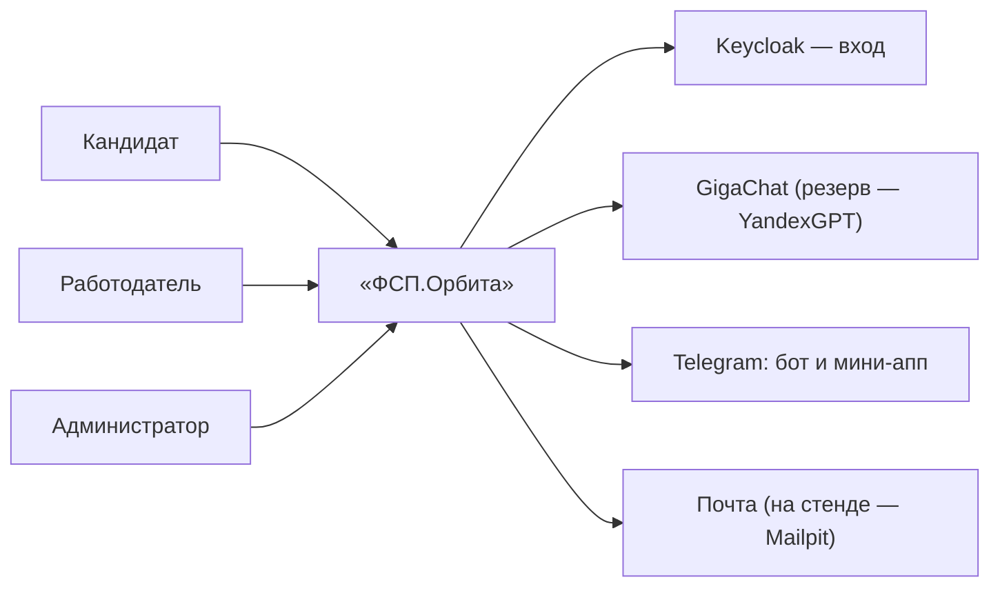
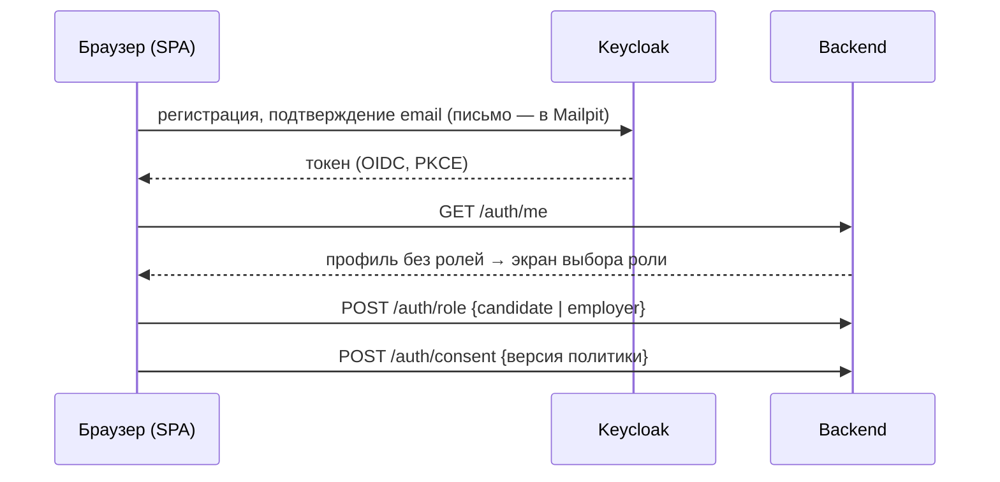
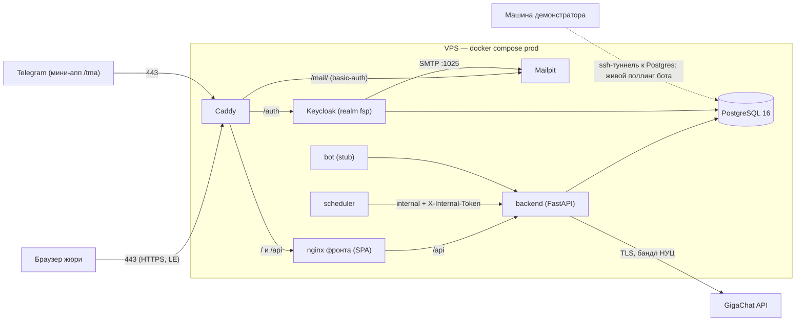

# Функциональная и компонентная архитектура

Документ описывает устройство «ФСП.Орбиты»: кто и с чем взаимодействует, из каких
контейнеров собран стенд, как устроены модули backend и модель данных, как данные движутся
по основным сценариям и как разграничен доступ. Схемы нарисованы по фактической
конфигурации развёртывания и кода. Разделы 10–13 дополняют картину частями, появившимися
по ходу разработки: телеграм-ботом, дайджестами, мини-CRM и прод-топологией стенда.

## 1. Контекст (C4, уровень 1)

С платформой работают три роли. Кандидат ведёт профиль, проходит адаптивный тест и получает
подтверждённую категорию — дальше его находят работодатели. Работодатель описывает
потребность в специалисте, получает ранжированную подборку с объяснением каждой позиции
и первым пишет кандидату — приглашение без зарплатной вилки «от–до» система не примет.
Администратор видит каталог шаблонов заданий и агрегаты целостности тестовых сессий;
расширенного доступа к данным кандидатов у него нет.

Внешних зависимостей немного. Вход и учётные записи обслуживает Keycloak (realm `fsp`):
регистрация, подтверждение email и сброс пароля происходят в нём, но роли и бизнес-данные
он не хранит. Свободные ответы теста оценивает языковая модель: основной провайдер —
GigaChat, резервный — YandexGPT; без ключей backend работает на встроенных
провайдерах-заглушках, поэтому локальный запуск и проверка жюри не требуют секретов.
Телеграм подключён двумя способами — ботом и мини-приложением (раздел 10); письма на стенде
перехватывает Mailpit («почта стенда»), так что подтверждение email работает без настоящего
SMTP. Реестр ФСП в MVP реального API не предоставляет: модель данных достижений и маппинг
спортивных дисциплин в узлы графа уже заложены в схему и справочники, а предлагаемый
контракт интеграции описан в `05-fsp-integration.md`.

## 2. Контейнеры (C4, уровень 2)

Всё хозяйство собирается `docker compose` в двух конфигурациях. Локальная `dev` поднимает
postgres, Keycloak, Mailpit, одноразовый контейнер миграций и backend; фронтенд при
разработке живёт на хосте (vite, порт 5173, прокси `/api` → 8000), а профиль `full`
добавляет бота и фронтенд в контейнере (порт 3000). Прод-конфигурация на VPS
(`deploy/compose/docker-compose.prod.yml`) добавляет Caddy — единственный сервис с портами
наружу; цепочка запросов развёрнутого стенда и схема — в разделе 13.

| Контейнер | Основа | Назначение |
| --- | --- | --- |
| `caddy` (только VPS) | caddy:2 | край стенда: HTTPS Let's Encrypt; наружу открыты только 80/443 |
| `frontend` | nginx + сборка SPA | статика React-приложения, прокси `/api` → backend, блокировка `/api/v1/internal/*` |
| `backend` | свой образ (uvicorn, один воркер) | всё API под `/api/v1`, Swagger — `/api/v1/docs` |
| `migrate` | тот же образ backend | одноразовый `alembic upgrade head` перед стартом backend |
| `bot` | тот же образ backend | телеграм-бот и его встроенный планировщик: пуши и дайджесты (разделы 10–11) |
| `postgres` | postgres:16-alpine | данные приложения и Keycloak; порт наружу не публикуется |
| `keycloak` | keycloak:26 | аутентификация; на стенде смонтирован на пути `/auth` того же домена |
| `mailpit` | axllent/mailpit | «почта стенда»: письма подтверждения и сброса пароля; на стенде — `/mail/` за basic-auth |

Локальные порты: postgres 5432, Keycloak 8080, Mailpit 8025 (UI) и 1025 (SMTP),
backend 8000, фронтенд 5173 (vite) или 3000 (контейнер в профиле `full`).

Чего в составе осознанно нет. Отдельного Redis нет — кэш живёт в памяти процесса backend
(раздел 9). Файлового хранилища (S3/MinIO) нет — платформа файлы не хранит. Очередей задач
и Celery нет: фоновой работы мало, планировщик уведомлений работает внутри процесса бота,
а служебные операции запускаются через внутренние эндпоинты `/internal/*`. Realtime-каналов
(WebSocket, SSE) тоже нет — интерфейс перезапрашивает данные обычными запросами. Наконец,
вместо Kubernetes выбран compose: стенд живёт на VPS с 4 ГБ памяти, жюри запускает решение
одной командой, а перенос в k8s описан как путь развития (`09-beyond-mvp.md`); решение
зафиксировано в ADR-003 в репозитории.

## 3. Модули backend

Backend — модульный монолит на FastAPI: один процесс, но код разложен по модулям
`app/modules/*`, каждый со своим роутером, схемами запросов-ответов и сервисным слоем
(`router.py` / `schemas.py` / `service.py`, при необходимости — свой сид). Модули общаются
явными вызовами сервисов, поэтому границы хорошо видны, а роутеры проверяются тестами без
поднятой инфраструктуры.

- `auth` — вход в приложение: `GET /auth/me`, выбор роли при первом входе, согласие
  на обработку ПДн, удаление аккаунта; `permissions.py` — единственный источник списка
  прав для интерфейса.
- `skills` — справочники отраслей и специализаций, граф навыков и грейд-профили из
  YAML-каталогов; расчёт текущей силы подтверждений с затуханием.
- `candidates` — профиль кандидата, его категория и персональный слой графа
  (`GET /candidates/me/skill-states`): состояние каждого узла кандидата для подсветки
  «моего» графа поверх общего.
- `assessment` — банк шаблонов заданий, сессии теста, телеметрия честности прохождения,
  оценка ответов и разбор завершённой сессии.
- `llm` — единая точка вызова языковых моделей: провайдеры `gigachat`, `yandex`
  и офлайновые `stub` / `replay` / `rules`, санитайзер ПДн перед отправкой, журнал вызовов,
  дневной лимит токенов и ограничение параллельности.
- `matching` — ранжированная подборка кандидатов под потребность с объяснениями,
  приглашения с зарплатной вилкой, раскрытие контактов, воронка найма (раздел 12).
- `employers` — компания (личный или корпоративный профиль), участники с приглашением
  по коду без регистрации, потребности в специалистах.
- `fsp` — каркас интеграции с реестром ФСП: роутер зарезервирован, эндпоинты появятся
  вместе с реальным API реестра (`05-fsp-integration.md`).
- `tgbot` — привязка телеграм-чата по одноразовому коду, дайджесты и журнал исходящих
  сообщений `tg_outbox`.
- `tma` — Telegram Mini App: тонкие обёртки над теми же сервисами, что у веба;
  авторизация по подписи `X-Telegram-Init-Data` вместо JWT.
- `internal` — служебные эндпоинты по `X-Internal-Token`: проверка токена, сводка
  использования LLM, пересев демо-данных, немедленная рассылка дайджеста.

Сквозные примитивы собраны в `app/core`: конфигурация (pydantic-settings), асинхронная
работа с БД (SQLAlchemy 2), единый формат ошибок `{code, message, details, request_id}`,
проверка токенов Keycloak и ролей, шифрование и маскирование ПДн, аудит, health-проверки,
кэш в памяти с TTL и пагинация. CLI-инструменты живут в `app/tools`: идемпотентный сид
данных (`seed`), ротация ключей шифрования ПДн (`rekey`), ожидание миграций при старте
контейнеров (`check_migrations`), процесс бота (`bot`) и дымовая проверка LLM-провайдера
(`llm_smoke`).

## 4. Модель данных

Схема — PostgreSQL 16; миграции Alembic пишутся вручную и автоматически сверяются
с моделями. Таблицы складываются в несколько групп:

- **пользователи и аудит** — `app_user` (роли, согласия, шифрованные ПДн) и `audit_log`,
  журнал значимых действий «кто, что, когда»;
- **справочник навыков** — `industry`, `specialization`, `skill_node`, `skill_edge`,
  `grade_profile`, `fsp_discipline_map`; заполняется сидом из YAML-каталогов;
- **кандидат** — `candidate_profile`, `survey_response`, `achievement_claim`
  и `fsp_achievement` (заявленные и верифицированные достижения), `skill_confirmation`
  (подтверждения узлов с источником и датой), `candidate_skill_state` (текущая сила
  каждого узла), `candidate_category` (присвоенные категории);
- **тестирование** — `task_template` и `task_variant` (банк шаблонов и сгенерированные
  варианты с лимитом использований), `test_session`, `test_item`, телеметрия
  `test_session_event` с агрегатом `test_session_integrity`, история грейдов `grade_history`;
- **работодатель и подбор** — `company` и `company_member`, `employer_need` с версиями
  `need_version` (подборка строится по зафиксированной версии потребности), `need_pin`,
  `vacancy`, `invitation`, `application`, `contact_grant` и `contact_reveal_audit`,
  регулярные задания `regular_task` / `regular_task_assignment`, воронка найма
  `need_pipeline_entry` / `pipeline_stage_event`;
- **телеграм** — `tg_link`, `tg_link_token`, `tg_outbox` (раздел 10);
- **служебные и изолированные** — журнал вызовов моделей `llm_call` (без ПДн),
  `validation_run`, таблицы инструмента проверки жюри `pair_run` и `imported_candidate`.

Ключевые инварианты закреплены на уровне схемы, а не только в коде. Зарплатная вилка всегда
корректна: условия `salary_from > 0` и `salary_from ≤ salary_to` стоят CHECK-ограничениями
на вакансии и приглашении. Контакты кандидата нельзя получить в обход `contact_grant`:
право возникает только при принятии приглашения или отклике, а каждый факт расшифровки
фиксируется в `contact_reveal_audit`. Категория кандидата появляется только как итог
тестовой сессии и хранится со временем расчёта. Вариант задания имеет потолок
использований и выводится из общего пула, а персональные сценарии не выдаются другим
кандидатам. ПДн лежат только в шифрованных колонках с поисковыми blind-индексами (раздел 7).

## 5. Потоки данных

**Регистрация и первый вход.** SPA отправляет пользователя в Keycloak (OIDC с PKCE);
регистрация и подтверждение email происходят там, письмо на стенде попадает в Mailpit.
Вернувшись с токеном, приложение запрашивает `GET /auth/me`; у нового пользователя ролей
нет, поэтому фронт ведёт его на экран выбора роли (`POST /auth/role`), а затем — к согласию
на обработку персональных данных с фиксацией версии политики (`POST /auth/consent`).
Только после согласия в профиль можно записывать ПДн.

**Тест на грейд.** Кандидат с заполненной специализацией создаёт сессию
`POST /assessment/sessions` (без специализации — 409 `profile_incomplete`, при недавней
попытке — 409 `cooldown_active`); уже активная сессия возвращается как есть. Задания
выдаются по одному (`GET …/items/current`) без эталонов и рубрик; ответы сохраняются через
`POST …/answer`, а оценка откладывается до конца. Параллельно раннер теста шлёт телеметрию
честности (`POST …/events` — только длины и тайминги, текстов ответов там нет). Завершение
`POST …/finish` — синхронный вызов: в нём оцениваются ответы (свободные — языковой моделью
по рубрикам), записываются подтверждения узлов, делается снимок состояний и присваивается
категория; прокси держит под это таймаут 120 секунд. Вызов идемпотентен: повтор по уже
завершённой сессии возвращает сохранённый итог, а если оценка ещё идёт — 409
`grading_in_progress`, по которому фронт повторяет запрос. После завершения кандидату
доступны разбор последней сессии (`GET /assessment/sessions/last/review` — баллы, критерии
рубрик и обратная связь, без эталонов) и подсветка личного графа
(`GET /candidates/me/skill-states`). Подробно тестирование описано в `02-testing.md`.

**Подбор и приглашение.** Работодатель описывает потребность (`/needs`); выдача
`GET /needs/{id}/candidates` ранжирует кандидатов и объясняет позицию каждого (формулы —
`03-matching.md`). До принятия приглашения работодатель видит только псевдонимы.
Приглашение создаётся с обязательной вилкой «от–до»; кандидат видит его в кабинете,
отметка просмотра переводит статус «отправлено» в «просмотрено». Принятие создаёт
`contact_grant`, и контакты открываются обеим сторонам (`GET /invitations/{id}/contacts`,
с записью в аудит); отказ сохраняется с причиной. Дальнейшее движение по стадиям найма —
мини-CRM (раздел 12).

**Телеграм.** Привязка чата по одноразовому коду, пуши о приглашениях и недельный дайджест
описаны в разделах 10–11; мини-приложение (`/tma/*`) использует те же сервисы, что и веб.

## 6. Роли и доступ

Keycloak отвечает только на вопрос «кто это» — роли и права он не хранит. Роль лежит в БД
(`app_user.roles[]`) и выбирается пользователем при первом входе; `candidate` и `employer`
из токена дописываются в БД, а `admin` живёт только в токене и в БД не сохраняется —
отзыв роли в Keycloak действует немедленно. Интерфейс строит навигацию по списку
`permissions` из `GET /auth/me` — это единственный источник правды для UI, однако backend
фронту не доверяет и дублирует каждую проверку на эндпоинтах. До выбора роли у пользователя
есть лишь базовые права: посмотреть себя, выбрать роль, дать согласие, удалить аккаунт
и читать справочник навыков.

Служебный контур отделён от пользовательского. Эндпоинты `/internal/*` защищены заголовком
`X-Internal-Token` (сравнение за постоянное время) и наружу не проксируются nginx'ом
фронта — до них дотягиваются только процессы внутри docker-сети. Мини-приложение Telegram
авторизуется подписью `X-Telegram-Init-Data` вместо JWT. Приглашённый через бот HR работает
наблюдателем без учётной записи на платформе; его действия в аудите записываются на
владельца корпоративного профиля (раздел 10).

## 7. Персональные данные

К ПДн платформа относит email, ФИО, телефон, телеграм-идентификаторы и контакты компании.
Такие поля хранятся только в шифрованных колонках (Fernet), а искать по ним помогает
blind-индекс — HMAC-отпечаток значения, по которому можно сравнивать, не расшифровывая;
ключи ротируются инструментом `rekey`. Согласие на обработку фиксируется отдельным
действием с версией политики, публикация контактов — отдельным флагом; без согласия запись
ПДн невозможна (403). Удаление аккаунта (`DELETE /auth/account`) помечает учётку удалённой,
и повторный вход не восстанавливает ПДн из токена. Перед обращением к языковой модели текст
проходит санитайзер; в логи, кэш и журнал `llm_call` персональные данные не попадают,
а наружу уходят псевдонимы («Кандидат B-7F3A») и маскированные значения. Подробности
и соответствие 152-ФЗ — `security-152fz.md`.

## 8. Модель компетенций

Подбор держится на модели компетенций. Для каждой специализации (бэкенд, фронтенд, данные)
описан граф навыков из трёх слоёв: D — глубина (фундамент профессии), B — база (ежедневная
практика), C — контекст (инструменты и среда). Узел графа подтверждается из нескольких
источников — тестом, верифицированными достижениями ФСП, регулярными заданиями — и каждое
подтверждение затухает со временем: период полураспада зависит от источника и слоя,
фундамент забывается медленнее, инструментальный контекст устаревает быстрее. Текущая сила
узла определяет его состояние (свежий, тускнеющий, истёкший) — именно эти состояния
подсвечивают личный граф кандидата. Грейд присваивается по профилям грейдов: на целевом
подграфе должно быть активно достаточно узлов и выполнены структурные условия — например,
выход за пределы одного слоя. Числовые параметры (веса, полураспады, пороги) живут в YAML
рядом с кодом (`graph.yaml`, `grade_profiles.yaml`); полное описание модели и формул —
в документе «Модель компетенций» (`skills-model.md`).

## 9. Ограничения архитектуры MVP

Backend работает в один экземпляр и один воркер — осознанно: кэш с TTL, ограничение
параллельности обращений к LLM и дневной потолок токенов считаются в памяти процесса,
что снимает целый класс проблем синхронизации, но не масштабируется горизонтально без
доработки. Push-каналов нет: обновления статусов доходят до интерфейса обычными
перезапросами, и при реальной нагрузке это первая точка роста. Банк шаблонов заданий лежит
в репозитории YAML-файлами — удобно для разработки и проверки, но в промышленной
эксплуатации его место вне кода. Интеграция с реестром ФСП работает на собственной модели
данных без внешнего API — контракт предложен в `05-fsp-integration.md`. На публичном стенде
включён демо-режим теста (`TEST_DEMO_MODE`): повторное прохождение доступно через
300 секунд вместо боевых 90 дней, чтобы тест можно было пройти несколько раз за одну
проверку. Сценарии масштабирования и снятия этих ограничений — `09-beyond-mvp.md`.

## 10. Телеграм-бот

Один бот (`@OrbitaFspBot`) обслуживает обе стороны; роль определяется
привязкой, а не отдельными ботами.

- **Привязка deep-link.** В настройках кабинета пользователь получает одноразовый
  `/start`-токен (TTL, одна попытка) и ссылку `t.me/<бот>?start=<токен>`; `/start` с токеном
  связывает чат с учёткой. Личный профиль (кандидат) и корпоративный (компания работодателя)
  — раздельные привязки; один телеграм-аккаунт может держать обе, активный контекст
  переключается командой в боте.
- **HR-инвайт без платформы.** Владелец корпоративного профиля генерирует одноразовый
  код приглашения; нанимающий менеджер активирует его в боте и получает доступ наблюдателя
  к пайплайну и дайджестам компании **без регистрации на платформе**. Действия, меняющие
  данные (приглашение кандидата, перевод стадии), требуют полноценной учётки — код можно
  «повысить» до неё при первом входе на платформу.
- **Транспорт и деплой.** Long polling (не нужен публичный URL и вебхук), отдельный процесс
  тем же образом backend — по образцу `scheduler`. Токен — `TELEGRAM_BOT_TOKEN` в env;
  **стаб-режим** (`TELEGRAM_BOT_MODE=stub`): процесс поллинга не стартует, исходящие
  уведомления пишутся в журнал `tg_outbox` (`GET /internal/tgbot/outbox`) — локальная
  разработка и запуск у жюри работают без секретов. На публичном стенде стаб-режим
  вынужденно боевой: хостер VPS фильтрует исходящий трафик к `api.telegram.org`,
  поэтому живой поллинг на демо запускается с машины демонстратора через ssh-туннель
  к Postgres стенда ([`08-run.md`](08-run.md) §10).
- **ПДн.** До принятия приглашения в бот не уходит ничего персонального: только псевдонимы
  («Кандидат B-7F3A»), категории, статусы и ссылки в кабинет. Контакты в чат не пересылаются
  никогда — после принятия бот даёт ссылку на страницу контактов в кабинете. Идентификаторы
  чатов храним как ПДн-смежные (шифрование как у `telegram_enc`).

## 11. Недельный дайджест

- **Подписки.** Кандидат подписывается на дайджест вакансий по своей категории и фильтрам;
  работодатель — на дайджест новых кандидатов под конкретную потребность (по снимку
  последней версии подборки: кто добавился, кто вырос в score).
- **Сборка и канал.** Планировщик (тот же `scheduler`-контейнер) собирает дайджест раз
  в неделю (cron-дефолт на проде — по аналогии с `REGULAR_TASK_INTERVAL`); канал MVP —
  телеграм-бот, email — после MVP. Содержимое без ПДн: псевдонимы, категории, score,
  ссылки в кабинет.
- **Демо.** Ручной запуск джобой `/internal/*` плюс короткий интервал стенда (по образцу
  `DEMO_REGULAR_TASK_SECONDS`) — жюри видит дайджест за минуты, не в понедельник 09:00.

## 12. Мини-CRM: пайплайн найма

- **Стадии.** Воронка по потребности/компании поверх приглашений и откликов: `отправлено →
  просмотрено → принято → интервью → оффер → нанят | отказ`. Первые четыре статуса уже живут
  в `invitation`; стадии после принятия — надстройка мини-CRM, канбан-доска в кабинете
  работодателя. Приглашение остаётся неизменяемым снимком — стадия живёт рядом, не внутри
  оффера.
- **История.** Каждый переход — запись «кто, когда, откуда → куда, комментарий» (на базе
  `audit_log`); карточка кандидата в пайплайне показывает хронологию.
- **Права.** Стадии двигает работодатель (владелец корпоративного профиля; приглашённый
  через бот HR — наблюдатель, см. §10); кандидат видит свою стадию в кабинете; админ —
  только чтение. Контакты по-прежнему только через `contact_grant` — пайплайн доступ
  к ПДн не расширяет.
- **Границы.** Это минимальный пайплайн внутри сервиса, не ATS: без вложений, писем
  и интеграций. Обмен с внешними ATS — `09-beyond-mvp.md` §2 и `roadmap.md`.

## 13. Прод-топология стенда

Факт по развёрнутому стенду <https://orbita.185.239.51.92.nip.io>
(профиль `deploy/compose/docker-compose.prod.yml`; процедура деплоя — [`08-run.md`](08-run.md) §8).

- **Цепочка запросов**: Caddy (80/443, автоматический HTTPS Let's Encrypt, единственный
  сервис с портами наружу) → nginx фронта (раздаёт SPA, SPA-fallback включая `/tma/*`,
  проксирует `/api`) → backend (uvicorn, `/api/v1`). Keycloak смонтирован под тем же
  доменом на пути `/auth` (`KC_HTTP_RELATIVE_PATH=/auth`, прод-режим `start`) — SPA, API
  и логин живут на одном origin, CORS-исключений нет. «Почта стенда» (Mailpit) — `/mail/`
  за basic-auth Caddy (пользователь `mail`, пароль — см. материалы сдачи).
- **Внутренний контур**: nginx фронта не проксирует `/api/v1/internal/*` и
  `/api/v1/assessment/internal/*` — джобы (`scheduler`) и бот ходят в backend напрямую
  по внутренней docker-сети с `X-Internal-Token`.
- **Исходящие интеграции**: GigaChat по TLS с бандлом НУЦ Минцифры
  (`GIGACHAT_CA_BUNDLE=/opt/certs/russian_trusted_bundle.pem`); `api.telegram.org`
  с VPS фильтруется хостером, поэтому на стенде `TELEGRAM_BOT_MODE=stub` (§10).

