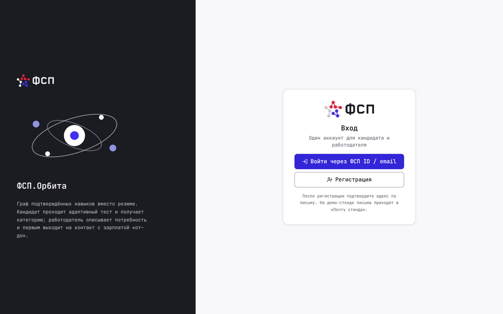
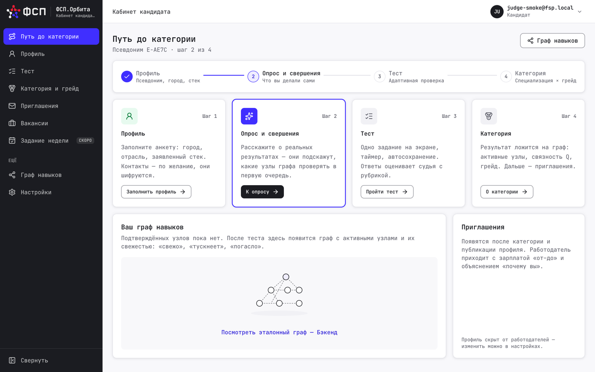
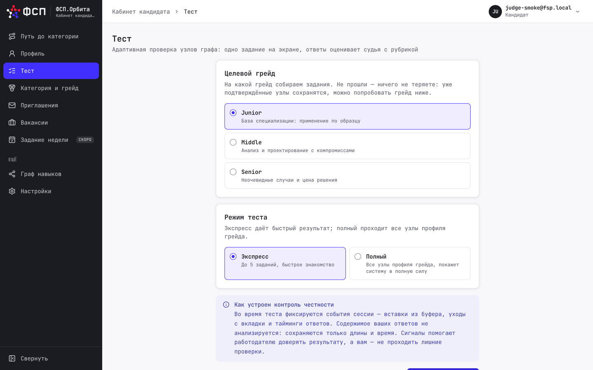
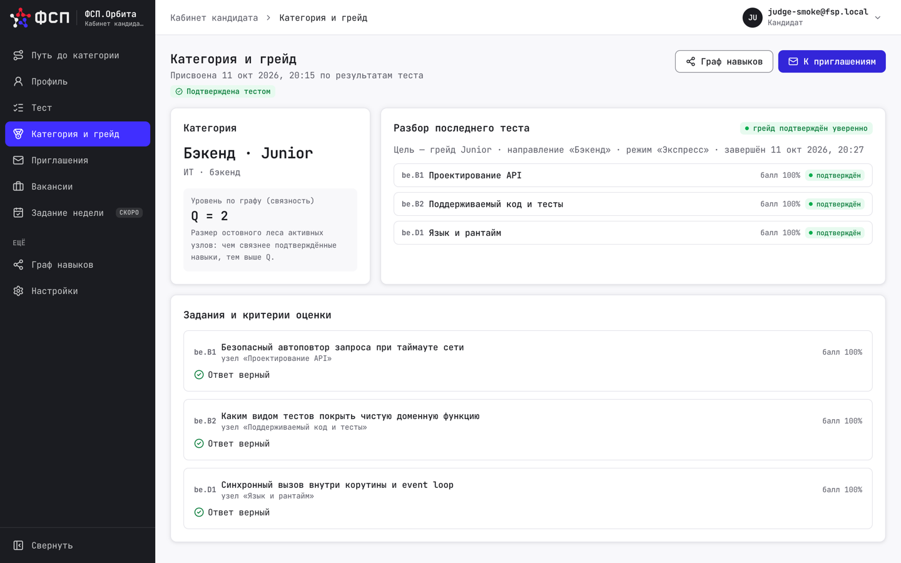
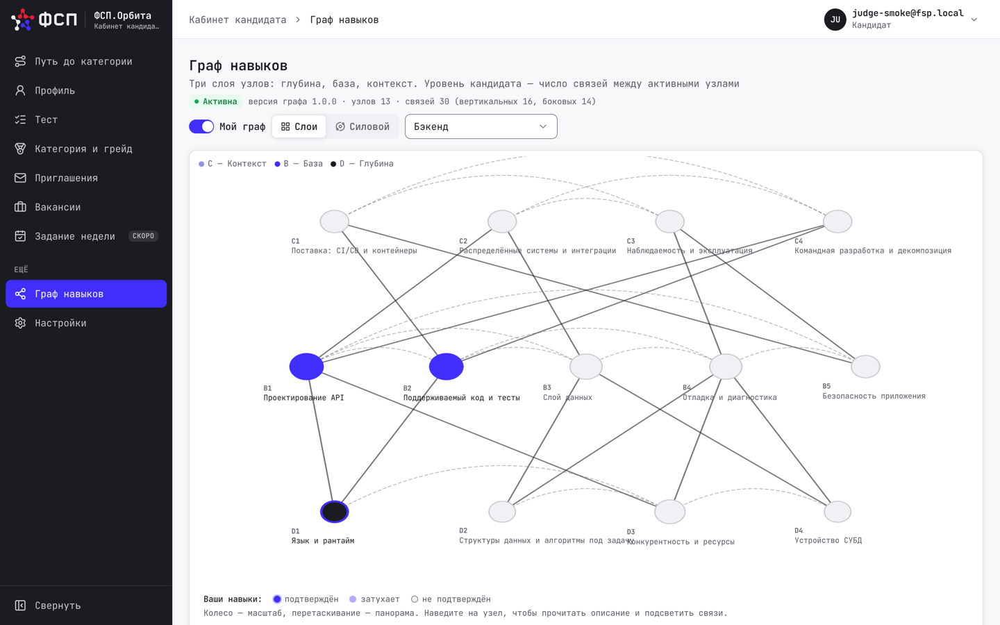
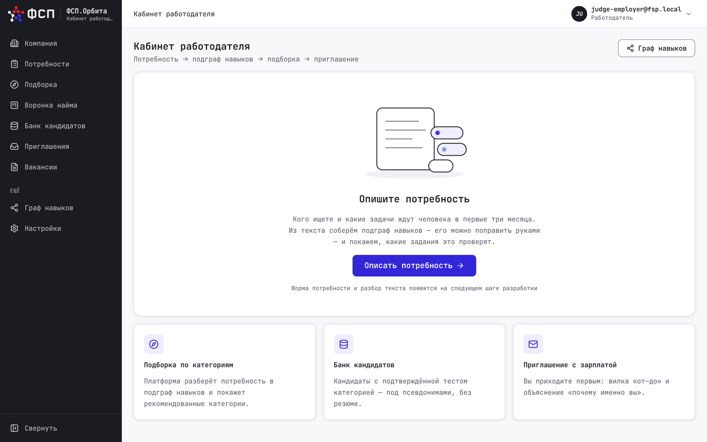
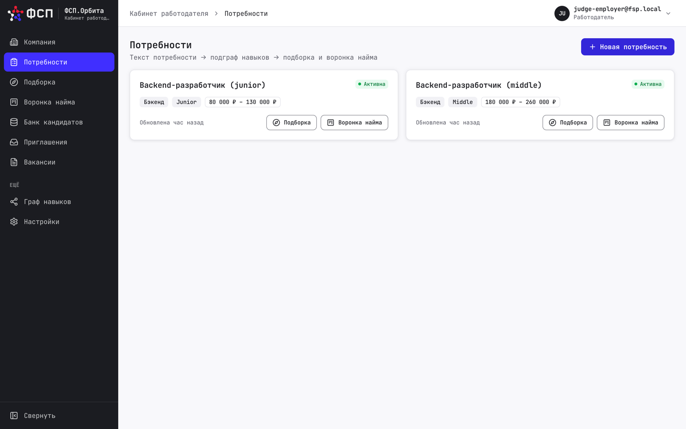
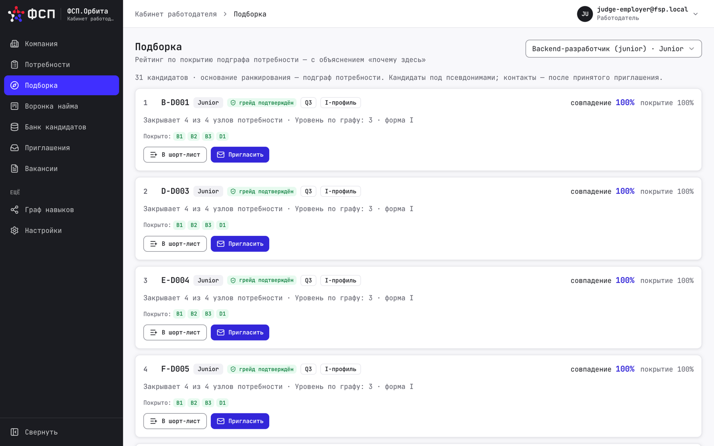
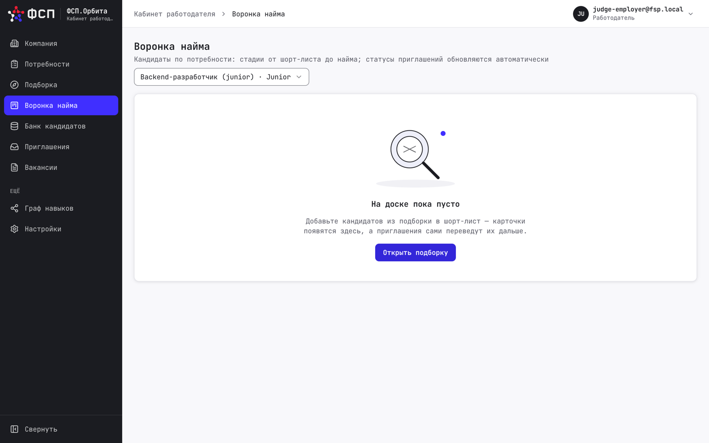

# Интерфейс системы

Раздел показывает основные экраны «ФСП.Орбиты» на живом стенде — в том виде, в котором их
увидит жюри. Интерфейс выполнен в фирменном стиле ФСП: шрифт JetBrains Mono, синий и красный
фирменные цвета, тёмная боковая навигация. Все данные на снимках синтетические: демо-аккаунты,
псевдонимы кандидатов, вымышленные компании.

## Вход и роли

Вход единый — через ФСП ID (на стенде его роль играет Keycloak с realm `fsp`). После первого
входа пользователь выбирает роль: кандидат или работодатель; роль хранится на стороне
платформы, а не в токене.

## Путь кандидата

Кабинет кандидата построен вокруг «пути до категории»: заполнить профиль, дать согласие,
пройти тест — и получить категорию, которую видят работодатели. Каждый шаг подсвечен,
кандидат всегда видит, что осталось сделать.

Перед тестом кандидат выбирает целевой грейд и режим: экспресс на несколько заданий для
быстрого знакомства или полный прогон всех узлов профиля грейда. Здесь же объясняются
сигналы честности: фиксируются только события сессии — вставки из буфера, уходы с вкладки
и тайминги, — содержимое ответов не анализируется.

После завершения теста кандидат видит категорию, уровень связности Q и полный разбор:
балл и состояние каждого проверенного узла, задания с критериями оценки и советами,
что подтянуть до следующего грейда.

## Граф навыков

Граф навыков — общая карта специализации: три слоя узлов (глубина, база, контекст)
и связи между ними. Кандидат включает режим «Мой граф» и видит своё положение на карте:
подтверждённые узлы залиты цветом слоя, затухающие — приглушены, неподтверждённые —
серым контуром.

## Путь работодателя

Работодатель начинает с кабинета компании: потребности, подборка, воронка найма
и банк кандидатов.

Потребность — это подграф навыков вакансии: работодатель отмечает узлы с важностью
must / should / nice, и система ищет кандидатов по покрытию этого подграфа.

Подборка — объяснимый рейтинг: по каждому кандидату видно, сколько узлов потребности он
закрывает, его уровень по графу и форму профиля. Кандидаты показаны под псевдонимами;
контакты раскрываются только после того, как кандидат принял приглашение с зарплатной
вилкой.

Принятые приглашения попадают в воронку найма — встроенный мини-конвейер от шорт-листа
до оффера, без выгрузки во внешнюю CRM.

